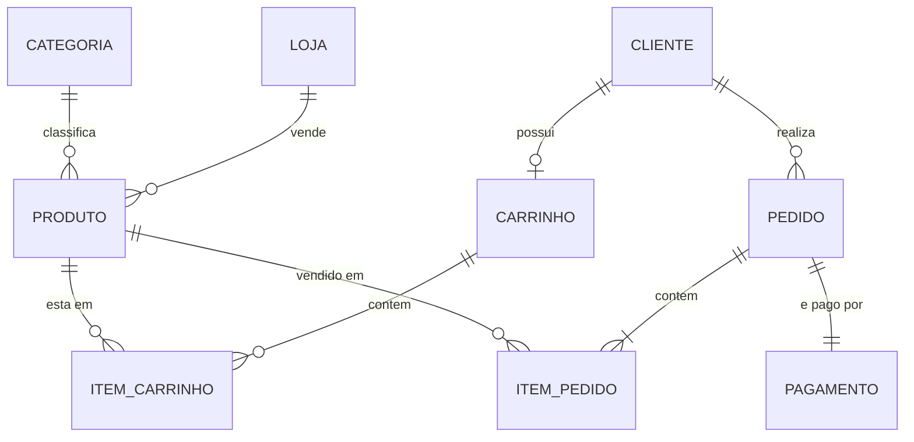

# Documentação de Requisitos — Marketplace de Livros

## 1. Visão geral
Sistema desktop (Java/Swing) de loja online com marketplace de livros. Lojas parceiras cadastram e
vendem livros (novos ou usados) pela plataforma; clientes pesquisam, compram e pagam.
Baseado na observação de marketplaces como Amazon, Mercado Livre e Estante Virtual.

## 2. Atores
- **Cliente:** pesquisa livros, usa carrinho, compra e paga.
- **Loja (lojista):** cadastra e mantém seus livros e acompanha vendas e relatórios.

## 3. Requisitos funcionais
| ID | Requisito | Tela / DAO |
|---|---|---|
| RF01 | Cadastrar cliente com validação (CPF, CEP, telefone, e-mail, senha) | TelaCadastro / ClienteDAO |
| RF02 | Autenticar cliente ou loja (e-mail + senha com hash SHA-256) | TelaLogin / LoginDAO |
| RF03 | Pesquisar livros por título/autor, categoria e faixa de preço | TelaPrincipal / ProdutoDAO |
| RF04 | Loja cadastrar livro (título, autor, preço, estoque, condição, categoria) | TelaMeusLivros / LivroDAO |
| RF05 | Loja alterar preço e estoque dos próprios livros | TelaMeusLivros / LivroDAO |
| RF06 | Cliente adicionar livro ao carrinho, respeitando o estoque | Menu Compras / CarrinhoDAO |
| RF07 | Cliente visualizar o carrinho com total, remover item e esvaziar | TelaCarrinho / CarrinhoDAO |
| RF08 | Finalizar compra: gerar pedido, itens, baixar estoque e registrar pagamento (transação única) | TelaCarrinho / PedidoDAO |
| RF09 | Pagar por PIX, cartão (1 a 12 parcelas) ou boleto (pendente até confirmar) | TelaCarrinho / PedidoDAO |
| RF10 | Cliente consultar pedidos, livros comprados e status do pagamento; confirmar pagamento pendente | TelaPedidos / PedidoDAO |
| RF11 | Loja consultar vendas por livro e comprador | TelaRelatorios / RelatorioDAO |
| RF12 | Relatórios: total vendido por loja, pedidos por status, ticket médio, estoque baixo, extremos de preço por categoria | TelaRelatorios / RelatorioDAO |

## 4. Requisitos não funcionais
| ID | Requisito |
|---|---|
| RNF01 | Java com interface Swing; banco SQL Server via JDBC |
| RNF02 | Senhas armazenadas apenas como hash SHA-256 |
| RNF03 | Todas as consultas usam `PreparedStatement` (proteção contra SQL injection) |
| RNF04 | Compra e confirmação de pagamento executadas em transação (commit/rollback) |
| RNF05 | Arquitetura em camadas: model / dao / view / util |
| RNF06 | Executável por JAR (`java -jar dist/MarketplaceLivros.jar`) |

## 5. Regras de negócio
- RN01: não é possível colocar no carrinho mais unidades do que o estoque.
- RN02: na finalização, o estoque é rebaixado com `WHERE estoque >= quantidade`; se faltar, a compra inteira é desfeita.
- RN03: o item do pedido guarda o preço da época da compra (`preco_unitario`).
- RN04: PIX e cartão são aprovados na hora (pedido "Pago"); boleto fica "Pendente" / "Aguardando pagamento".
- RN05: a loja só altera livros com o próprio `cod_loja`.
- RN06: cada cliente possui um único carrinho; cada pedido possui um único pagamento.

## 6. Casos de uso (resumo)
- **UC01 Comprar livros:** cliente pesquisa → adiciona ao carrinho → abre o carrinho → finaliza → escolhe a forma de pagamento → pedido criado.
- **UC02 Gerir livros:** loja entra → *Minha loja > Meus livros* → cadastra ou altera.
- **UC03 Consultar desempenho:** loja entra → *Minha loja > Relatórios* → escolhe o relatório.
- **UC04 Quitar boleto:** cliente → *Meus pedidos e pagamentos* → seleciona o pedido pendente → confirma.

## 7. Modelo de dados (DER)

Entidades (9): `cliente`, `loja`, `categoria`, `produto`, `carrinho`, `item_carrinho`, `pedido`, `item_pedido`, `pagamento`.
Script: `sql/schema.sql`.

## 8. Atendimento às limitações do trabalho
| Exigência | Atendimento |
|---|---|
| Mínimo de 5 entidades | 9 entidades |
| Mínimo de 5 operações com condicionais/agregação | 7: total por loja (SUM/GROUP BY), pedidos por status (COUNT/GROUP BY), ticket médio (AVG/MIN/MAX), estoque baixo (WHERE), extremos por categoria (MIN/MAX), total do carrinho (SUM), verificação de cadastro (COUNT) |
| Mínimo de 5 operações com junções | 7: catálogo, carrinho, histórico de compras, pedidos + pagamento, vendas da loja, livros da loja + categoria, itens no fechamento da compra |

Consultas completas em `sql/queries.sql`.
